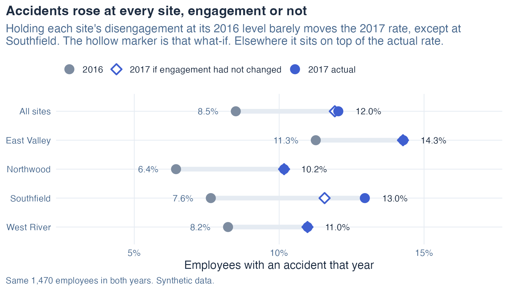
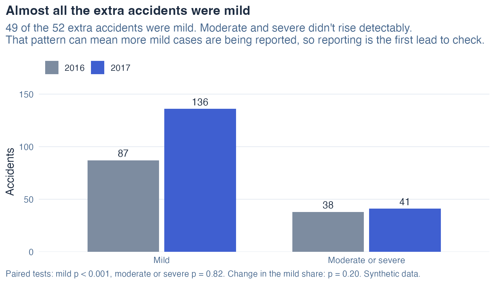
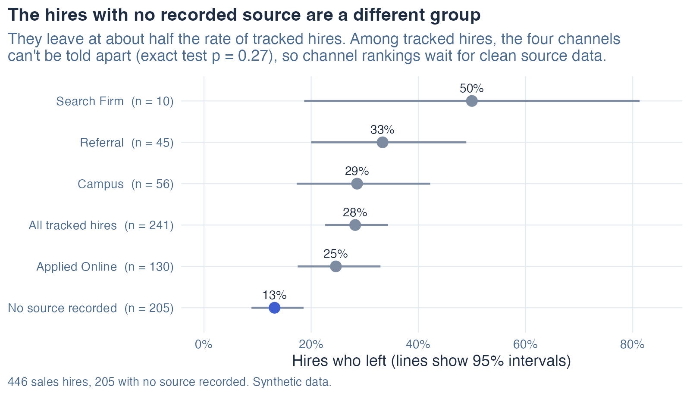
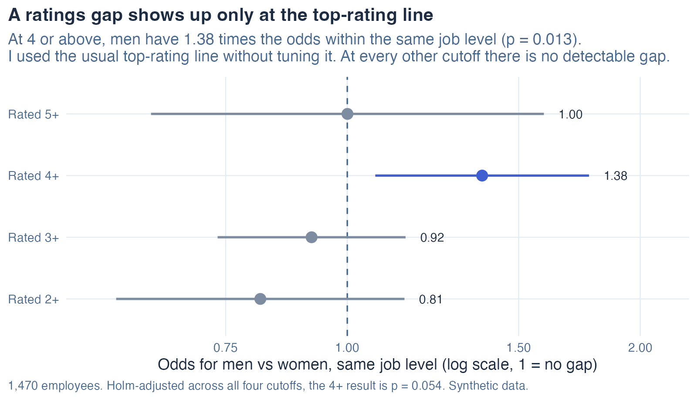

# Why accidents rose at every site

Two questions an HR team gets asked, answered on a synthetic 1,470-person company in R. Why did workplace accidents go up? Which recruiting channel brings in the best sales hires? In both cases the quick read of the data points at the wrong fix. I check the data first and test the obvious explanation before I rank anything, and each case ends in one action with an owner. I wrote up a third check, on performance ratings, as what a calibration review should look at next. The questions are the standard ones people ask of this dataset. What I added is the checking.



## Summary

The quick read blames a rise in accidents on disengagement at Southfield, the one site where it jumped. I held each site's disengagement at its 2016 level and recomputed 2017: the companywide rate would still be 11.9%, against an actual 12.0% and 8.5% a year earlier. Disengagement accounts for about 3% of the rise. Accidents also rose among engaged staff at all 4 sites, and 49 of the 52 extra accidents were mild (87 to 136), while moderate and severe ones didn't rise detectably (38 to 41). My recommendation to the safety lead is to check whether incident reporting changed in 2017 before funding an engagement program.

On recruiting, the "channel" with the best quota attainment is the 205 of 446 hires (46%) with no source recorded. They leave far less often than tracked hires (13% vs 28%), so the missing source isn't random. With them set aside, the four named channels can't be told apart on quota or on attrition. My recommendation to the talent acquisition lead is to make source a required field before moving any budget between channels.

## Problem

Each case starts from a question someone with a budget would ask. The company and its people are synthetic, so the askers are roles.

| Case | Who asks | The decision on the table | What the quick read says |
|---|---|---|---|
| Accidents | Safety lead, operations leadership | Fund an engagement program at Southfield? | Southfield had the biggest rise, and it is the only site where disengagement went up noticeably, so fix engagement there |
| Recruiting | Talent acquisition lead | Move recruiting budget toward the best channel? | Rank channels by quota attainment and attrition, and the "Not recorded" group wins |
| Ratings | HR business partner, ratings calibration | Review how top ratings are given? | Men get more 4s and 5s, but they also sit in higher job levels |

In both lead cases, acting on the quick read would put money into a fix that misses the cause.

## Inputs

| File | Rows | What it holds | Used for |
|---|---|---|---|
| hr_data_2.csv | 2,940 | Employee, year (2016, 2017), site, overtime hours | Accidents |
| accident_data.csv | 302 | Employee, year, accident type (mild, moderate, severe) | Accidents |
| survey_data_2.csv | 2,940 | Employee, year, engagement score 1 to 5 | Accidents |
| recruitment_data.csv | 446 | Sales hires: source, quota attainment, attrition, rating | Recruiting |
| hr_data.csv, performance_data.csv | 1,470 each | Employee, department, job level, gender, rating 1 to 5 | Ratings |
| survey_data.csv | 1,470 | Engagement, department, salary, vacation days | Also checked |
| fair_pay_data.csv | 1,470 | Salary, job level, new hire flag | Also checked |

The data is DataCamp's synthetic HR dataset. I couldn't find terms that clearly allow sharing copies, so I don't redistribute it: `get_data.R` downloads the eight public files and checks each against a stored checksum, so a changed file stops the run.

**What synthetic means here.** 302 to 2,940 rows is about the size of a real 1,500-person company's HR data, so the methods carry over. But one pattern is clearly planted: 97.6% of employees have the same engagement score in both years, nobody's score went up, and 29 of the 31 people who moved into the disengaged range (a score of 1 or 2) work at Southfield. That pattern looks constructed, so I treat the engagement results as an illustration of the method, and I wouldn't size a program on them.

## Discovery

**The accident data is the same people twice.** All 1,470 employees appear in both years and none changed site. So I used paired tests (McNemar) and standard errors grouped by employee, which match how the data was collected. An unpaired test gives the same answer here (p = 0.002 either way).

**The biggest site rise isn't a standout.** Southfield rose most (+5.3 points), but after a Holm correction for testing 4 sites its paired test is p = 0.15. Every site went up.

**The missing source data isn't missing at random.** Hires with no source recorded have lower attrition (13% vs 28%, p < 0.001) and higher quota attainment (1.17 vs 1.01 of quota, p = 0.019, or 0.057 after correction). That one group drives the "channels differ on attrition" result in the full data.

**Dead ends.** Overtime didn't change significantly at any site, and it has no link to accidents (p = 0.82), so it doesn't explain the rise either. Vacation days have no link to engagement (r = -0.01), so I dropped them as a possible driver.

## Execution

```
get_data.R ── data/ (8 CSVs, checksummed, gitignored)
     │
run_all.R ── R/01_accidents.R ─┐
          ── R/02_recruiting.R ─┼── outputs/results.txt      (every table and test)
          ── R/03_ratings.R    ─┤   outputs/key_numbers.csv  (the numbers this README quotes)
          ── R/04_also_checked.R┘   outputs/chart_*.csv
     │
make_charts.R ── figures/
tests/ ── checks the README against key_numbers.csv, and the data checks against bad input (CI)
```

1. **Data checks that stop the run.** I check each file's row count and keys on load, and every join for lost or duplicated rows. A broken join changes every rate after it without any error, so the run stops instead of warning.
2. **Accidents breakdown.** For each site I kept the 2017 accident rates of engaged and disengaged staff, gave the site its 2016 share of disengaged staff, and recomputed the 2017 rate. The gap between that and the actual 2017 rate is the part of the rise that more disengagement can account for. A second method, a model fitted on both years and used to predict 2017 with each person's 2016 engagement, gives the same picture.
3. **Recruiting.** I compared untracked with tracked hires first, then compared channels on tracked hires only. Fisher's exact test replaces chi-squared because Search Firm has 10 hires.
4. **Ratings.** I used the usual "high performer" line, a 4 or 5, without tuning it, and show every other cutoff and each job level next to it, so the choice of line can't drive the result.
5. **Holm adjustment within each set of related tests:** the accident headline tests, the four sites, the recruiting headline tests, the four rating cutoffs and the three job levels. I report raw and adjusted p-values side by side.

Choices I made and what each cost are in [DECISIONS.md](DECISIONS.md).

## Results

### Accidents: check reporting before funding an engagement program

| | 2016 | 2017 | Test |
|---|---|---|---|
| Employees with an accident | 8.5% | 12.0% | Paired p = 0.002, odds ratio 1.47 (1.16 to 1.87) |
| 2017 if disengagement had stayed at 2016 levels | | 11.9% | Disengagement explains about 3% of the rise |
| Engaged staff only | | | Odds ratio 1.53 (1.14 to 2.05), p = 0.005, rose at all 4 sites |
| Mild accidents | 87 | 136 | Paired p < 0.001 |
| Moderate or severe | 38 | 41 | Paired p = 0.82 |
| Share of accidents that were mild | 69.6% | 76.8% | p = 0.20 |

At Southfield, disengagement rose from 19% to 29% and explains between about an eighth and a quarter of that site's rise (12% to 26% by two methods). Across the company it explains almost none of it.

The shift toward mild accidents is suggestive, and the change in mix isn't significant on its own (p = 0.20). So reporting is the first lead to check, and I don't present it as the answer.



- **Owner:** safety lead.
- **Action:** find out whether anything changed in how incidents get reported in 2017 (a new form or channel, a wider definition of a reportable incident, a push to report near misses). If it did, part of the rise is better reporting, which is good news. If nothing changed, look at what all four sites have in common in 2017.
- **What to check after 30 days:** a yes or no on a 2017 reporting change, and the mild and moderate-or-severe rates per site, tracked monthly from then on.

### Recruiting: make source a required field before ranking channels

| | Hires | Left | Quota attainment |
|---|---|---|---|
| No source recorded | 205 | 13% | 1.17 |
| All tracked hires | 241 | 28% | 1.01 |
| Channels differ? (tracked only) | | Exact test p = 0.27 | ANOVA p = 0.55 |



The untracked group could be hires from a channel nobody logs, rehires, or internal transfers. The data can't say which. Until source is recorded for every hire, any channel ranking rests on 54% of the hires. Search Firm's 10 hires give a quota attainment interval from 0.31 to 1.47, too wide to judge.

- **Owner:** talent acquisition lead.
- **Action:** make source a required field in the applicant tracking system, and ask recruiters what the 205 untracked hires have in common.
- **What to check after 30 days:** the share of new hires with a source recorded, aiming for all of them. Compare channels again after a full hiring cycle.

### Ratings: what a calibration review should look at next

Men are rated 4 or 5 more often (32.5% vs 21.5%). Part of that is job level: men are more often in salaried and manager roles, where top ratings are more common. Within the same job level, men still have 1.38 times the odds of a 4 or 5 (95% interval 1.07 to 1.77, p = 0.013). A Mantel-Haenszel test gives the same answer (1.37, p = 0.016).



The gap appears only at the 4-or-above line. At 2+, 3+ and 5+ the odds ratios are 0.81, 0.92 and 1.00, none significant. The gap doesn't differ detectably by job level (p = 0.59). Hourly roles hold 71% of employees and are the only level where the gap is significant on its own (p = 0.026): women there get more 3s (37% vs 28%) and fewer 4s (13% vs 18%). Holm-adjusted across the four cutoffs, the 4+ result is p = 0.054. Across the three levels, the hourly result is p = 0.078. I treat it as a signal worth a review. It doesn't prove bias. There is also no promotion data: if promotions favor one group, controlling for job level hides part of the gap, so the true gap could be larger than 1.38.

- **Owner:** HR business partner running ratings calibration, with legal counsel involved before any work on real employee data.
- **Action:** in the next calibration, review the 3-versus-4 decisions side by side by gender, starting with hourly roles because that is where most people are.
- **What to check:** the share of 4+ ratings by gender within each level, every cycle.

### Also checked

- **Engagement by department.** Sales has about 2 to 2.8 times the odds of disengagement of other departments, holding salary and vacation fixed, at every cutoff I tried (1.96, 95% interval 1.52 to 2.52, at a score of 2 or below).
- **New-hire pay.** New hires earn $2,650 more on average (p = 0.019). Within job level I found no premium I could detect: $783 (95% interval -$235 to $1,800, p = 0.13). Pay spreads much more among managers than among salaried staff, so I checked with robust (HC3) standard errors, and classical and HC3 agree. The log-salary version agrees (+1.3%, p = 0.078). In hourly roles new hires earn $1,107 more. New and current employees don't differ detectably in job level mix (p = 0.16).

### What I'd need from real data

- Incident logs with the date a report was filed and the channel used, to test the reporting explanation directly.
- Hire source for every hire, plus requisition and cost data, to rank channels on cost per quality hire.
- Promotion history and rater IDs, to tell a ratings gap from a promotion gap and to see whether a few raters drive it.

## Limits

- Synthetic data with at least one planted pattern (engagement). The methods carry over to real data, but these numbers don't describe any real company.
- Two years only, so I can't separate a trend from a one-year jump.
- Gender is recorded as two values, and there is no data on race, age or tenure for the ratings check.
- The scripts run many tests. I correct within each set of related tests, and the raw and adjusted values are both in `outputs/results.txt`.

## How to run

Needs R 4.4 with readr, dplyr, tidyr, broom, sandwich, lmtest, ggplot2 and testthat.

```
Rscript get_data.R     # download the 8 CSVs and verify checksums
Rscript run_all.R      # all four analyses -> outputs/
Rscript make_charts.R  # charts -> figures/
Rscript tests/run_tests.R
```

## Repo map

| Path | What |
|---|---|
| `get_data.R` | Downloads and checksums the data |
| `R/helpers.R` | Loading, data checks, intervals, model output with any standard-error type |
| `R/01_accidents.R` to `R/04_also_checked.R` | One script per case |
| `outputs/results.txt` | Every table and test from the last run |
| `outputs/key_numbers.csv` | The numbers this README and the card quote, checked by the tests |
| `tests/` | README-number check and data-check tests, run in CI |
| `DECISIONS.md` | Options, choices and trade-offs |

Data: synthetic HR data, downloaded from its public links and not included here. Code: MIT license.
